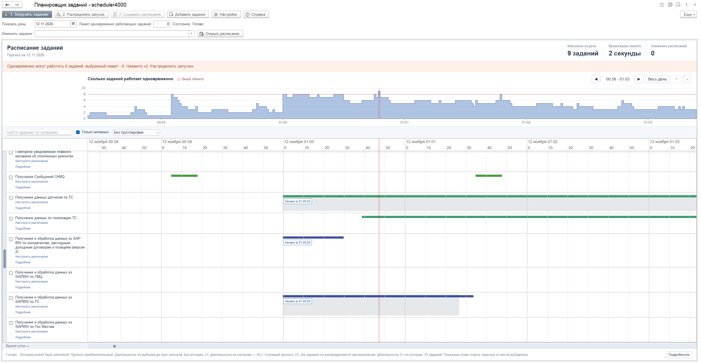
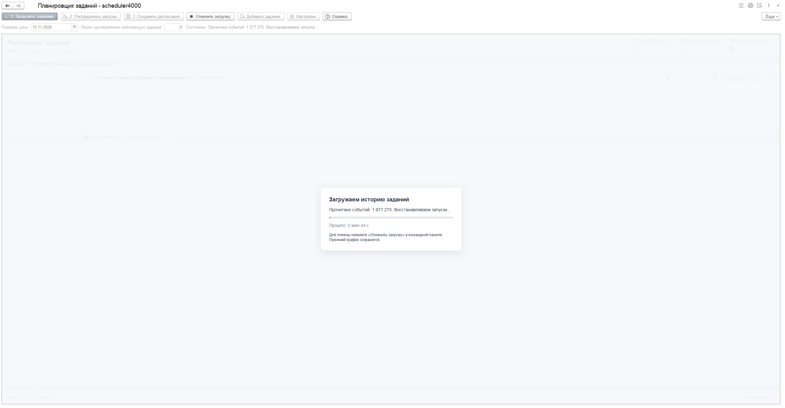

# scheduler4000

Внешняя обработка для 1С:Предприятия 8.3: прогноз одновременного выполнения регламентных заданий и распределение их запусков.

Обработка показывает общий график нагрузки и диаграмму Ганта, оценивает длительность по истории и позволяет сравнить расписания до записи в базу. Это прогноз количества одновременно работающих заданий; загрузку CPU и число процессов `rphost` он не измеряет.

## Скриншоты

Общий график нагрузки и расписание заданий:

Загрузка истории с отображением прогресса:

## Установка и начало работы

1. Скачайте готовый `scheduler4000.epf` из раздела **Releases**. При получении полного комплекта папкой файл находится в ее корне; рядом доступны документация и лицензии.
2. Откройте EPF в управляемом приложении 1С под полноправным администратором информационной базы.
3. Нажмите **1. Загрузить задания**, выберите дату и лимит одновременных заданий.
4. Изучите графики, измените расписания вручную или нажмите **2. Распределить запуски**.
5. После проверки результата нажмите **3. Сохранить расписания**. До этой команды расписания в базе не меняются.

## Возможности

- Общая шкала времени, увеличение, прокрутка и перетаскивание запусков в черновике.
- Длительность по истории: среднее или максимум до трех успешных запусков за выбранные 24/48 часов; ручной режим и отдельная длительность для заданий без истории.
- Одно чтение журнала регистрации за период с освобождением промежуточных коллекций после обработки.
- Распределение запусков с учетом лимита и ограничений расписаний, отмена расчета и откат черновика.
- Правый клик на верхнем графике ставит черную пунктирную линию через обе панели; следующий правый клик по любому графику снимает ее.
- Встроенная справка и библиотеки графиков; интернет во время работы не требуется.

## Совместимость и проверки

Проверенная платформа — **8.3.27.2074**, управляемые тонкий и толстый клиенты. Нативный стенд — **ТОиР Автотранспорт 1.0.52.00**, режим совместимости 8.3.21, БСП 3.1.9.162. Наличие источников истории зависит от конфигурации и настроек журнала регистрации.

Автоматический комплект содержит **128 проверок JavaScript**. Полная приемка подтверждена пользователем 11.11.2026. Подробности и границы проверок приведены в [описании проверок](docs/testing.md); перенос в иную конфигурацию требует проверки в ее тестовой копии.

## Документация и разработка

- [Руководство пользователя](docs/user-guide.md).
- [Сборка из исходников](docs/build.md).
- [История выпусков](CHANGELOG.md).

Исходники обработки находятся в `EPF/`, тесты — в `tests/scheduler4000/`. Для запуска тестов установите Node.js; проверенная версия — 24.21.0. Из корня репозитория выполните `npm test`. Установка npm-пакетов не требуется.

## Лицензия

Собственный код распространяется по [MIT](LICENSE). Встроенные библиотеки имеют отдельные условия: [перечень и тексты лицензий](THIRD-PARTY-NOTICES.md).
